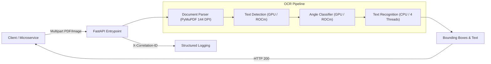

# 🚀 ROCm OCR Microservice

[](https://github.com/gganssauge/rocm-ocr/actions/workflows/ci.yaml)
[](https://sonarcloud.io/dashboard?id=gganssauge_rocm-ocr)
[](https://www.python.org/downloads/release/python-3120/)
[](https://rocm.docs.amd.com/)
[](https://onnxruntime.ai/)
[](https://renovatebot.com/)
[](LICENSE)

A standalone, domain-agnostic, and production-ready **OCR inference microservice** accelerated by **AMD ROCm GPUs** (specifically optimized for consumer **AMD Radeon RX 7800 XT / RDNA3 / `gfx1101`**).

Built on top of **FastAPI**, **RapidOCR**, and **ONNX Runtime ROCm**, it delivers sub-second to low-second document text detection and character recognition without requiring proprietary NVIDIA CUDA hardware.

---

## 🌟 Highlights & Key Features

- **⚡ Hardware Acceleration for AMD RDNA3:** Exploits AMD ROCm via `ROCMExecutionProvider` on consumer cards (`gfx1101`), running side-by-side with other GPU workloads (such as Ollama).
- **🇩🇪 German Language & Full Diacritics Support:** High-accuracy multilingual models (`PP-OCRv6_small_rec`) supporting 50 languages with flawless recognition of German umlauts (`ä`, `ö`, `ü`, `ß`), capitalization, and special characters.
- **🏎️ Optimized Hybrid Pipeline:** Text detection and angle classification execute on the GPU; text recognition runs with tuned multi-core CPU threading (`intra_op_num_threads=4`) to circumvent RDNA3 kernel bugs while maintaining blistering throughput.
- **🔍 Production Observability:** Full correlation ID propagation via `asgi-correlation-id` (`X-Correlation-ID`) across HTTP headers and structured access logs.
- **🤫 Focused & Transparent Logging:** Built-in log filters suppress routine Kubernetes health check noise (`200 OK` on `/healthz` & `/readyz`); native MIOpen and GPU diagnostics remain visible without process-wide stderr redirection.
- **🛡️ Fail-Fast Reliability:** Hardware or GPU driver exceptions transparently return `HTTP 503 Service Unavailable` with diagnostic error payloads — strictly avoiding silent CPU fallbacks that degrade cluster performance.
- **🔄 Dynamic Concurrency Tuning:** Runtime adjustable inference slots via `/ocr/v1/setup` to balance GPU memory between microservices.

---

## 📊 Performance Benchmarks

Measured live inside a Kubernetes (`k3s`) production cluster on a single **AMD Radeon RX 7800 XT (16 GB)** sharing GPU resources concurrently with an active Ollama instance:

| Test Document | Content | Pure CPU Baseline | **ROCm OCR Microservice** | Speedup |
| :--- | :--- | :---: | :---: | :---: |
| **Standard Invoice** | 1 Page, 59 Bounding Boxes | 4.15 s | **1.36 s** | **~3.05× faster** |
| **Bundestagsdrucksache** | 1 Page, Dense Government Text (38 Boxes) | 5.15 s | **2.38 s** | **~2.16× faster** |

> **Note:** Timings represent full round-trip HTTP requests, including multi-part upload, PyMuPDF rendering at 144 DPI, GPU text detection, angle classification, text recognition, and JSON serialization. Direct HTTP overhead is **< 15 ms**.

---

## 🏗️ Architecture & Pipeline



---

## 🚀 Quickstart

### 1. Local Development (Strictly Python 3.12 via `uv`)

```bash
# Clone repository
git clone https://github.com/gganssauge/rocm-ocr.git
cd rocm-ocr

# Install dependencies (strictly Python 3.12)
uv sync --all-groups

# Run local development server
bash scripts/setup_rocm_compat.sh
LD_LIBRARY_PATH="$PWD/lib/rocm${LD_LIBRARY_PATH:+:$LD_LIBRARY_PATH}" \
  uv run uvicorn rocm_ocr.main:app --host 0.0.0.0 --port 8000 --reload

# Run comprehensive test suite
uv run pytest
```

### 2. Docker Container

Build and run using the self-contained multi-stage Docker image:

```bash
# Build the image
docker build -t rocm-ocr:local .

# Run with direct AMD GPU pass-through
docker run --rm -d \
  --name rocm-ocr \
  -p 8000:8000 \
  --device=/dev/kfd \
  --device=/dev/dri \
  --group-add video \
  --group-add render \
  --security-opt no-new-privileges \
  --cap-drop ALL \
  rocm-ocr:local
```

### 3. Kubernetes / k3s GitOps Deployment

Production manifests are structured with Kustomize under [`deploy/k8s/`](deploy/k8s/):

The standard pod is nonprivileged, runs as UID/GID 1000, drops all capabilities
and uses a read-only root filesystem with writable temporary/cache volumes.
**GPU access under this hardened Kubernetes configuration is not yet verified.**
The runtime must grant device access independently of hostPath mounts; otherwise
readiness returns HTTP 503. Validate on the target cluster before rollout.

```bash
# Apply namespace, service, and deployment
kubectl apply -k deploy/k8s/

# Monitor rollout status
kubectl rollout status deployment/rocm-ocr -n ocr

# Run in-cluster end-to-end verification
uv run python scripts/test_k8s_e2e.py --keep
```

---

## 🔌 API Reference & Usage

### Interactive API Docs

When running, interactive OpenAPI/Swagger documentation is available at:
`http://localhost:8000/docs`

### Key Endpoints

| Method | Path | Description |
| :--- | :--- | :--- |
| `GET` | `/healthz` | Kubernetes liveness probe (HTTP 200). Suppressed from access logs. |
| `GET` | `/readyz` | Kubernetes readiness probe. Verifies GPU provider and engine readiness. |
| `POST` | `/ocr/v1/setup` | Dynamically configures maximum concurrent inference tasks. |
| `POST` | `/ocr/v1/predict` | Executes OCR text extraction on uploaded PDF or raster images. |
| `POST` | `/ocr/v1/sandwich` | Executes OCR and injects an invisible text layer to produce a searchable PDF. |

Uploads are limited to **50 MiB per HTTP request body** (including multipart
framing), **100 PDF pages**, and **20 million rendered pixels per page or raster
image**. Exceeding these limits returns HTTP 413, including for born-digital PDFs.
See the [resource-limit contract](docs/spec.md#26-document-resource-limits).

### Prediction Example (`curl`)

```bash
curl -X POST "http://localhost:8000/ocr/v1/predict" \
  -H "X-Correlation-ID: my-trace-id-12345" \
  -F "file=@sample_invoice.pdf"
```

#### Sample Response

```json
{
  "execution_provider": "ROCMExecutionProvider",
  "inference_time_ms": 1359.1,
  "pages": [
    {
      "page_number": 0,
      "width": 595.3,
      "height": 841.9,
      "boxes": [
        {
          "text": "Rechnung Nr. 2026-0042",
          "bbox": [54.0, 72.5, 230.1, 88.0],
          "confidence": 0.9852
        },
        {
          "text": "Fälligkeitsdatum: 31.10.2026",
          "bbox": [54.0, 95.0, 245.5, 110.2],
          "confidence": 0.9914
        }
      ]
    }
  ]
}
```

---

## 📖 In-Depth Documentation

For detailed architectural decisions, MIOpen solver mechanics, GitOps integration, and production configuration parameters, refer to the full specification:
👉 **[Full Documentation & Architecture Guide (docs/DOCUMENTATION.md)](docs/DOCUMENTATION.md)**

---

## 📄 License

This project is licensed under the [MIT License](LICENSE).
